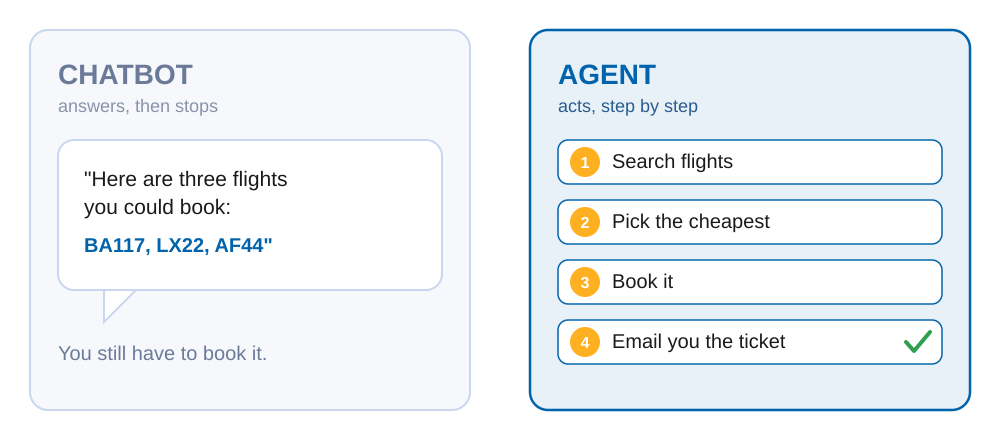
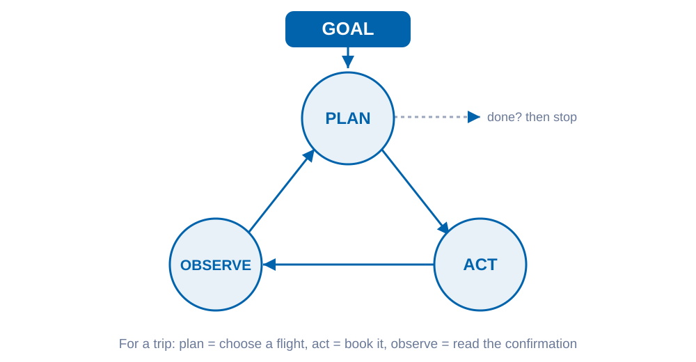
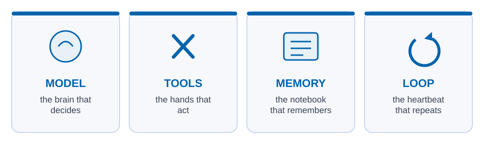
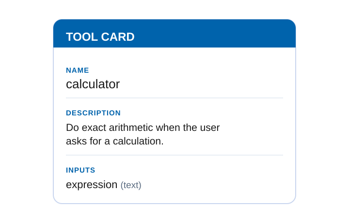
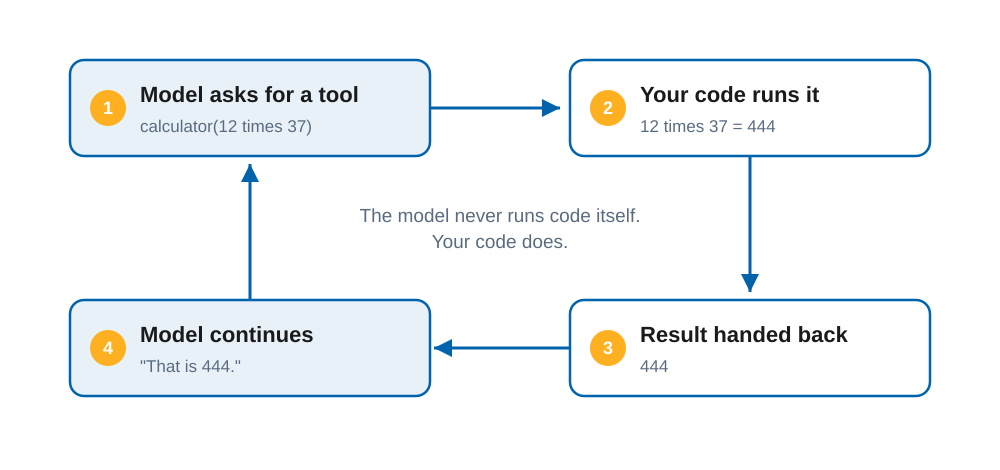
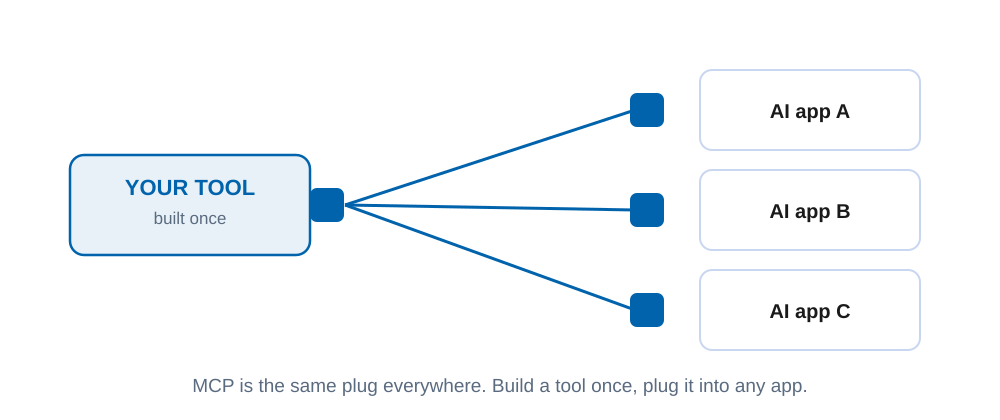
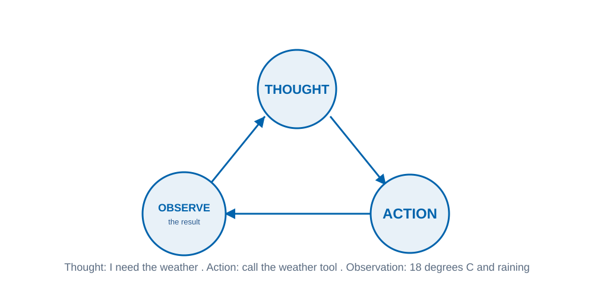
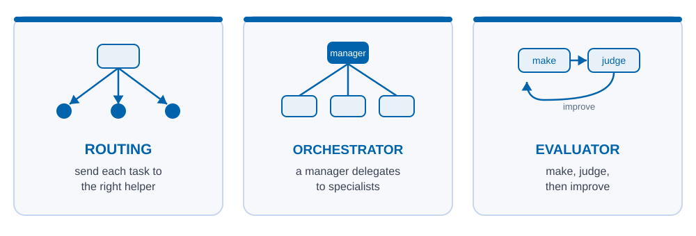

<!-- _class: lead -->

# Agentic Mechanics: Planning & Tool Use

A hands-on day for beginners: how AI agents plan and use tools

**UNDP Istanbul International Center for Private Sector in Development**
Agentic AI & Vibe Coding

Prepared by Alan Al-Jammoor

<!-- Speaker notes: Welcome everyone warmly. This is a full day built for beginners and non-coders. No prior coding needed. Ask the room what made them curious enough to join. -->

---

## Who this is for, and our promise

- Beginners and non-coders are warmly welcome
- No prior coding experience needed, we start from zero
- We explain every term in plain words, the first time it appears
- By the end of today, you will have built a small AI agent yourself

<!-- Speaker notes: Make the promise concrete. Some people may feel out of place; tell them this day was designed for exactly them. Ask: "Who here has never written a line of code?" -->

---

## The day at a glance

- **Foundations**  what an agent is, and the loop at its heart
- **Tool Use**  how an agent reaches out and does things
- **Planning**  how an agent decides what to do next
- **Putting it together**  shapes, safety, and good judgement
- **Hands-on notebooks**  you read, run, and edit small agents all day

<!-- Speaker notes: Walk the arc of the day. Stress the rhythm: a little theory, then a notebook, repeated, so the ideas always land in something they can run. -->

---

## How today works

- We read, run, and observe together in **Google Colab**, nothing to install
- Ask a question at any time, nothing is too basic
- You use your own **Anthropic API key**, entered safely at run time
- We go at a beginner pace and pause often

<!-- Speaker notes: Set the working rhythm: read a little, run a cell, watch, then make a small edit. Reassure about the key, it is entered privately and never saved into a file. -->

---

<!-- _class: divider -->

# Part A: Foundations

What an agent is, and the loop at its heart.

---

## A chatbot answers. An agent acts.

A chatbot tells you what to do. An agent goes and does it.

<!-- Speaker notes: Walk the trip example left to right. The chatbot stops at a list; the agent keeps going and finishes the job. Ask: "Which one would actually save you an afternoon?" -->

---

<!-- _class: center -->

## So, what is an agent?

An agent is an AI system that works toward a goal by deciding the next step, acting with a tool, looking at the result, and repeating until the goal is met.

<!-- Speaker notes: Read it slowly. The key words are goal, step, tool, result, repeat. The same model sits inside a plain chatbot; what makes it an agent is the loop around it. -->

---

## The loop at the heart of every agent

The goal goes in once. Then it plans, acts, and observes, over and over, until the job is done.

<!-- Speaker notes: Trace the loop with your finger. The agent takes one step, looks at what happened, and only then decides the next step. That is why it handles messy tasks. -->

---

## Four parts, working together

The model decides, the tools act, memory remembers, and the loop keeps it all going.

<!-- Speaker notes: Name each part and tie it back to the loop. Every agent we build today has these same four parts. Ask: "Which part does the actual booking, the brain or the hands?" -->

---

<!-- _class: center -->

# It is not magic. It is this loop, run with care.

You set the goal. You choose the tools. You can see every step.  Next, we give an agent its first tool.

<!-- Speaker notes: Demystify before the hands-on. Powerful, but no mystery inside, which is exactly what keeps you in control. Build anticipation for tools. -->

---

<!-- _class: divider -->

# Part B: Tool Use

How an agent reaches out and does things.

---

<!-- _class: center -->

## What is a tool?

A tool is a function the model can ask your code to run for it. The model proposes; your code does the work.

<!-- Speaker notes: Use the analogy of a colleague who can say "please use the calculator" but cannot press the buttons. The model asks, your code acts. -->

---

## On its own, a model has three gaps

<h3>No exact math</h3>It guesses at arithmetic.

<h3>No fresh data</h3>It cannot see today.

<h3>No actions</h3>It can only produce text.

A calculator, a search, and an action tool fix all three.

<!-- Speaker notes: These are not small flaws, they are the whole reason tools exist. Each gap maps to a kind of tool. -->

---

## A tool is just a card the model reads

Name, description, inputs. The model chooses a tool by reading its description.

<!-- Speaker notes: This three-part description is called a tool schema, a simple recipe card. The model never sees your code, only the card. -->

---

## The tool-use loop: ask, run, return, continue

Four steps, on repeat. The model asks, your code runs it and hands the result back.

<!-- Speaker notes: Walk it one step per finger. The key idea is turn-taking, like passing a baton. We run this exact loop in Notebook 1. -->

---

## The description is the steering wheel

<h3>Weak</h3>"does currency stuff"  The model is left guessing.

<h3>Strong</h3>"converts an amount from one currency to another, using today's rate"  It knows exactly when to use it.

<!-- Speaker notes: Read both aloud and let the contrast land. The strong one names the inputs and the moment to use the tool. -->

---

## When a tool fails, hand the failure back

A good tool returns a clear message, not a crash. The agent reads it and tries again.

weather("Springfield")  gives  "Error: many Springfields, add a country",  so the agent retries  weather("Springfield, USA")

<!-- Speaker notes: Errors are messages, not dead ends. A good error tells the model how to fix its request. -->

---

## MCP: one standard plug for tools

MCP (Model Context Protocol) is a shared standard, like a USB-C port for tools.

<!-- Speaker notes: A first look only. The big idea: one shared way to connect tools, so a tool built once works everywhere. -->

---

<!-- _class: handson -->

## Hands-on: Notebook 1

Open Google Colab

- Give a model a single calculator tool
- Watch it ask, your code run it, and the result go back
- See the model finish the answer on its own

You write your first agent code here.

<!-- Speaker notes: Get everyone into Colab and confirm Notebook 1 is open. Walk slowly; this is the first time they see the loop run for real. -->

---

<!-- _class: divider -->

# Part C: Planning

How an agent decides what to do next.

---

<!-- _class: center -->

## Why plan?

Planning means breaking a hard task into small steps, the same way a person would. Models do better one step at a time.

<!-- Speaker notes: Ask how they would plan a weekend trip. You do not book everything in one breath; you list steps. Models work better the same way. -->

---

## Chain of Thought: think step by step

Ask the model to show its working before the answer. The phrase that does it: "let us think step by step."

3 boxes of 8 apples, some sold  gives  "3 times 8 is 24, then subtract the ones sold..."

<!-- Speaker notes: Chain of Thought is just asking the model to show its working. It is the simplest trick in the whole day. -->

---

## ReAct: think, act, observe, repeat

The agent reasons and uses tools in the same flow. This is the key pattern for tool use.

<!-- Speaker notes: The most important pattern in this section. Walk the weather example. This loop is exactly what they watch in Notebook 2. -->

---

## Plan and Execute: write the plan, then do it

Best when the steps are known up front, like following a recipe.

<h3>1. Plan</h3>Find the customer email, draft a reply, send it.

<h3>2. Execute</h3>Do step 1, then step 2, then step 3.

<!-- Speaker notes: Contrast with ReAct. Here the model writes the whole plan before touching a tool. Great when the path is clear. -->

---

## Two habits that make agents reliable

<h3>Reflection</h3>The agent checks its own answer and improves it, like proofreading before you submit.

<h3>Replanning</h3>When a tool fails, it makes a new plan. The flight tool is down, so it tries the train.

<!-- Speaker notes: Reflection raises quality; replanning adds resilience. Both separate a robust agent from a fragile script. -->

---

## Pick the simplest pattern that fits

<h3>Simple task</h3>Just ask, or Chain of Thought.

<h3>Tool-heavy task</h3>Use ReAct.

<h3>Steps known up front</h3>Plan and Execute.

<h3>Quality matters most</h3>Add Reflection.

<!-- Speaker notes: The cheat sheet to photograph. Patterns can combine, like ReAct plus Reflection. Most beginners start with plain ReAct. -->

---

<!-- _class: handson -->

## Hands-on: Notebook 2

Open Google Colab

- Build a small ReAct loop from scratch
- Watch it print every Thought, Action, and Observation
- You literally see the agent reason

A planning pattern you can watch think.

<!-- Speaker notes: Run Notebook 2 together. The agent prints each Thought, Action, and Observation so they can watch it reason. Walk the room. -->

---

<!-- _class: divider -->

# Part D: Putting it together

Shapes, safety, and good judgement.

---

## Three handy agent shapes

<b>Routing</b> is best for many kinds of request, sending each one to the right specialist. 
<b>Orchestrator and workers</b> is best for one big task split into parts, for breadth and speed. 
<b>Evaluator and optimizer</b> is best when quality matters most: make, judge, then improve.

<!-- Speaker notes: Read the diagram, then the line below each idea: routing for variety, orchestrator for breadth and speed, evaluator for quality. Most real agents mix these. Ask which shape fits a task from their own work. -->

---

## Watch what the agent actually did

Logging and tracing record each step in order, so you can find exactly where it went wrong.

searched, read the result, called the calculator (went wrong here), wrote the answer

<!-- Speaker notes: Without logs a wrong answer is a mystery; with logs it is a detective case you can solve. Like a plane's black box. -->

---

<!-- _class: center -->

## Check the path, not just the answer

A right answer can come from luck. Look at the steps and tools the agent chose, not only the final result.

<!-- Speaker notes: Judging only the final answer hides bad habits that bite later. Like a student who gets the right total with messy, lucky math. -->

---

## Keep three things in check

<h3>Cost</h3>Cap the number of steps.

<h3>Speed</h3>Use the smallest model that works.

<h3>Safety</h3>Ask before risky actions.

These pull against each other. The job is balance, not perfection.

<!-- Speaker notes: The simplest safety habit: require a human yes before anything that spends money or deletes data. -->

---

<!-- _class: center -->

# Sometimes you should not use an agent

If one prompt or a fixed script does the job, use that. Agents add cost, delay, and surprises. Reach for one only when the steps really vary.

<!-- Speaker notes: The most senior advice of the day: avoid complexity you do not need. You do not hire a project manager to make a cup of tea. -->

---

<!-- _class: handson -->

## Hands-on: Notebooks 3 and 4

Open Google Colab

- **Notebook 3**: a multi-tool agent that picks the right tool
- **Notebook 4**: an agent that checks its own work and replans
- Then the **capstone** ties it all together

You build a small agent end to end.

<!-- Speaker notes: Run Notebooks 3 and 4 together, then point ahead to the capstone. Ask what task from their work would make a good capstone. -->

---

## What we built today

Every agent today was this one loop: goal, plan, act, observe, run with care.

<!-- Speaker notes: Bring the day full circle to the loop we opened with. Tools, planning patterns, and shapes are all ways to make this loop better. -->

---

## Your capstone

Build one small agent end to end. You pick the goal, the tools, and the pattern.

The brief and starter files are in the assignments folder.

<!-- Speaker notes: Frame the capstone as the natural next step, not a test. They already have every piece they need from today. -->

---

## Keep learning

A curated resource library sits alongside this deck, every link tagged by level and free to open.

Begin with the Start here list, then explore by topic.

<!-- Speaker notes: The Start here list is the gentle on-ramp, every entry beginner-friendly and free. Encourage them to bookmark it. -->

---

<!-- _class: lead -->

# Thank you

You built a small AI agent today. Keep going.

**UNDP Istanbul International Center for Private Sector in Development**

Prepared by Alan Al-Jammoor

<!-- Speaker notes: Close warmly and celebrate what the room accomplished, especially the non-coders. Invite final questions. -->
