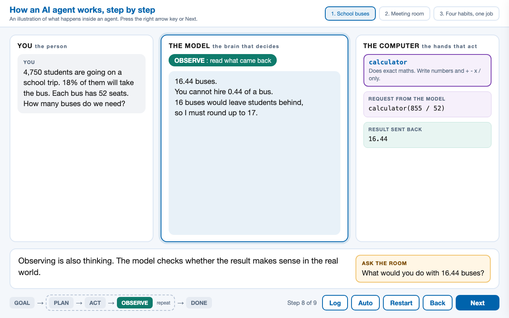
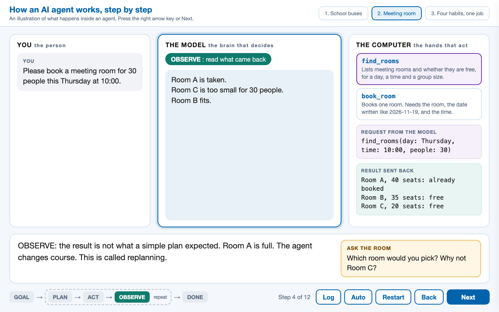
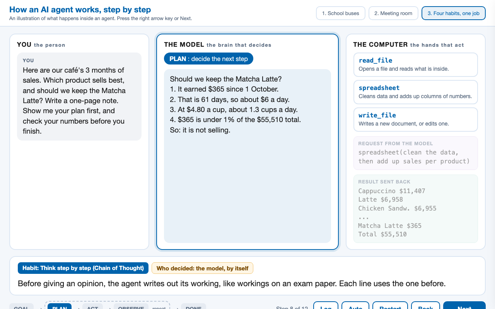

<!-- _class: lead -->

# Tool Use and Agentic Mechanics

Session 1: How AI agents think and act

**UNDP Istanbul International Center for Private Sector in Development**

Prepared by Alan Al-Jammoor

<!-- Welcome everyone. No coding today and nothing to install. Ask in the chat: "Have you used ChatGPT, Claude or a similar assistant? Type yes or no." Most will say yes. "Today we look at what happens when that kind of AI stops just answering and starts doing." -->

---

<!-- _class: center -->

## An AI agent made this

<video src="assets/cafe_promo.mp4" controls></video>

<!-- HOOK, 3 minutes. Play the 30 second video (when screen sharing, tick "share tab audio"). Then say: "An AI agent made this, starting from a messy spreadsheet of café sales. Nobody edited it. Today you learn how that works. Next session, you watch it happen." -->

---

## Today, in plain words

- **Five ways to set up AI**, and why an agent is different
- **Inside an agent**: the loop that powers it
- **Tools**: how an AI reaches out and does things
- **Planning**: four habits that make an agent work well

No coding. Live animations, polls and questions in the chat.

<!-- Keep this under a minute. Promise: by the end, everyone can explain how an AI agent works to a friend, using real examples. Ask people to keep the chat open. -->

---

<!-- _class: divider -->

# Part 1: Five ways to set up AI

Not all AI is the same. Here is the map.

---

## A ladder of five levels

<!-- Walk up the ladder one step at a time, about a minute each. Each level adds one thing to the one before. 1: just the model, text in and text out. 2: the same model with extras, like search or your files. 3: several AI steps in a fixed order that a PERSON designed. 4: the model decides its own steps, in a loop. 5: a team of agents. Point to the bracket at the bottom: that is the line that matters. -->

---

## One everyday example per level

| Level | Example |
|-------|---------|
| **1. LLM** (large language model) | "Rewrite this email to sound more polite." |
| **2. Augmented LLM** | "What time is the last bus?" It reads the timetable PDF first. |
| **3. Workflow** | Every Monday: summarise new feedback, sort it by topic, draft the report. Same steps every time. |
| **4. Agent** | "Book a room for 30 people on Thursday." It searches, finds the usual room is full, and picks another. |
| **5. Multi-agent** | A researcher agent, a writer agent and a fact checker agent produce one report together. |

<!-- Read two or three rows aloud, not all. Ask in the chat: "Which of these have you already used?" Most people have used 1 and 2. Define LLM: a large language model, the AI that reads and writes text. The level 4 example is one you will watch step by step later today. -->

---

<!-- _class: center -->

# Who decides the steps?

In a workflow, a person decides the steps. In an agent, the model decides.

A workflow is a recipe you wrote. An agent is a cook you hired: you give the goal, it decides the steps.

<!-- Pause here. This is the most important sentence of Part 1. -->

---

<!-- _class: activity -->

## Quick quiz: which level would you use?

Poll, or type the number in the chat

<ol class="quiz">
<li>Translate a paragraph into French.</li>
<li>Answer questions about this year's bus timetable PDF.</li>
<li>Every Friday, turn the sign-up sheet into the same summary email.</li>
<li>Find a venue, caterer and date for 50 people under a budget, adapting when options fall through.</li>
<li>Write a 20-page market study, with research, writing and fact checking done by separate specialists.</li>
</ol>

<!-- 3 minutes. Read each one, give 10 seconds, ask people to type the level number in the chat (or use a Mentimeter or Slido poll). Read out a few answers. Reveal on the next slide. -->

---

## Answers

<h3>1. LLM</h3>Text in, text out.

<h3>2. Augmented LLM</h3>It needs the PDF.

<h3>3. Workflow</h3>Same steps every week.

<h3>4. Agent</h3>The steps change as it goes.

<h3>5. Multi-agent</h3>Different roles. But would one agent do?

Not everything needs an agent. Use the simplest level that does the job.

<!-- Higher is not better. Agents cost more, take longer and can surprise you. You do not hire a project manager to make a cup of tea. -->

---

<!-- _class: divider -->

# Part 2: Inside an agent

The loop at the heart of every agent.

---

<!-- _class: center -->

## So, what is an agent?

An agent is an AI that works toward a goal by deciding the next step, using a tool, reading the result, and repeating until the goal is met.

<!-- Read it slowly. Key words: goal, step, tool, result, repeat. The same model sits inside a plain chatbot. What makes it an agent is the loop around it. -->

---

## The loop, in plain words

<h3>PLAN = decide the next step</h3>"I need 18% of 4,750 students. I should not guess maths. I will use the calculator."

<h3>ACT = use a tool</h3>It sends a request: calculator(4750 x 0.18)

<h3>OBSERVE = read what came back</h3>The answer comes back: <b>855</b>. Now it knows something new.

Then it goes round again (855 students, 52 seats a bus: how many buses?) until the goal is met. Then it stops.

<!-- Every agent runs this loop. Make it concrete with the bus example: a school trip, 4,750 students, 18% take the bus, buses have 52 seats. Plan is just "decide the next step". Act is just "use a tool". Observe is just "read what came back". You will watch this exact example animated in a few minutes. -->

---

## Four parts, working together

The model decides, the tools act, memory remembers, and the loop keeps it going.

<!-- Brain, hands, notebook, heartbeat. In the bus example: the model decides to use the calculator (brain), the calculator does the maths (hands), it remembers 855 for the next step (notebook), and it goes round until the answer is found (heartbeat). -->

---

<!-- _class: divider -->

# Part 3: Tools

How an AI reaches out and does things.

---

<!-- _class: center -->

## What is a tool?

A tool is something the AI can ask the computer to do for it: calculate, search, read a file, book a room. The model asks. The computer does the work.

<!-- Analogy: a very smart colleague who can say "please use the calculator" but cannot press the buttons. -->

---

## On its own, a model has three gaps

<h3>No exact maths</h3>It predicts numbers like words. Often close, sometimes wrong.

<h3>No fresh information</h3>It cannot see today's prices, rooms or weather.

<h3>No actions</h3>It can only produce text. It cannot book or send.

A calculator, a search and an action tool fix all three.

<!-- These gaps are the whole reason tools exist. Each gap maps to a kind of tool. -->

---

## A tool is just a card the model reads

Name, description, inputs. The model picks a tool by reading its description.

<!-- The model never sees the code behind the tool, only this card. That is how it knew to pick the calculator: the card says "do exact arithmetic". -->

---

## The tool-use loop: ask, run, return, continue

<!-- Four steps, like passing a baton. The model asks for a tool, the computer runs it, the result goes back, the model continues. Now let us watch it happen. -->

---

<!-- _class: activity -->

## Watch it: the school bus question

<a class="open" href="../animation/agent-step-by-step.html#1">Open the animation: scenario 1</a>

<!-- 4 minutes. Open the animation in a new tab and share it. Press the right arrow to step. Pause where the yellow "Ask the room" box appears and ask the chat. Step 2 shows what happens WITHOUT a tool: the model guesses "about 16 buses", which would leave 23 students without a seat. Then watch: plan, act, observe, twice. Key question at step 4: "Who is actually doing the maths?" The computer. The model only asks. Press L at the end to show the log. -->

---

## When a tool fails, hand the failure back

<h3>1. A vague request</h3>calculator("18 percent of the students")

<h3>2. A helpful error</h3>"Error: write numbers only, for example 4750 x 0.18"

<h3>3. It tries again</h3>calculator(4750 x 0.18) gives <b>855</b>

A good tool returns a clear message, not a crash. The agent reads it and fixes its request.

<!-- Errors are messages, not dead ends. The error tells the model exactly how to fix its request. You will see this happen in the next animation too. -->

---

<!-- _class: activity -->

## Watch it: when the result changes the plan

<a class="open" href="../animation/agent-step-by-step.html#2">Open the animation: scenario 2</a>

<!-- 3 minutes. Booking a room for 30 people. Three moments to point out. Step 4: the usual room is full, so the agent changes its plan (this is called replanning). Step 6: it ASKS before booking, because booking affects other people. Step 9: the booking tool returns an error about the date format, and the agent fixes it. A fixed recipe could do none of this. -->

---

<!-- _class: optional activity -->

Optional: 60 min version

## The description is the steering wheel

<h3>Weak</h3>"does data stuff"  The model is left guessing when to use it.

<h3>Your turn, in the chat</h3>Rewrite it in 60 seconds so a model knows exactly <b>what</b> it does and <b>when</b> to use it.

<!-- 60 minute version only. Example strong answer: "Looks up a number from the sales table, such as total sales for a month. Use it when the question needs a figure from the sales data." Read out two answers from the chat. -->

---

<!-- _class: divider -->

# Part 4: Planning

Four habits that make an agent work well.

---

## You already have these four habits

Your manager asks for a one-page budget update by Friday. What do you do?

You <b>work out the sums</b> carefully, line by line.

You <b>look up</b> the figures you do not have.

You <b>make a to-do list</b> so nothing is forgotten.

You <b>read it again</b> before you send it.

Agents use the same four habits. Each one has a name.

<!-- Ask the chat first: "What would you do?" Collect answers, then reveal. People will name most of these habits themselves. That is the point: planning patterns are just good work habits, written down for AI. -->

---

## Why four? Each fixes a different way work goes wrong

| How work goes wrong | The habit that fixes it | Its official name |
|---------------------|-------------------------|-------------------|
| Rushing to an answer, and getting it wrong | **Think step by step** | Chain of Thought |
| Missing information, or needing to do something | **Look it up as you go** | ReAct (Reason + Act) |
| Losing track in a long job | **To-do list first** | Plan and Execute |
| Mistakes in the first draft | **Check and fix** | Reflection |

Four problems, four fixes. That is why there are four.

<!-- The official names come from research papers. You do not need to remember them, but you will see them online. Remember the plain names. Next: one slide per habit, each with one example. -->

---

## Habit 1: Think step by step

<h3>Rushed</h3>"The workshop is on the last Friday of the month. The month starts on a Tuesday and has 30 days. What date?"  <b>"The 30th?"</b> Wrong.

<h3>Step by step</h3>Day 1 is a Tuesday. So day 4 is a Friday. Fridays: 4, 11, 18, 25. The next would be 32: too late. <b>So: the 25th.</b>

<b>How it works:</b> write out the working, each line using the one before, and give the answer last. <b>When:</b> any answer that needs reasoning. <b>Who decides:</b> the model does it on its own; you can also ask "think step by step".

<!-- Official name: Chain of Thought. Like showing your working in a maths exam. No tool is needed here: it is pure reasoning. -->

---

## Habit 2: Look it up as you go

<h3>Think</h3>"Which rooms are free on Thursday at 10:00? I do not know. I will search."

<h3>Use a tool</h3>find_rooms(Thursday, 10:00, 30 people)

<h3>Read the result</h3>"Room A: full. Room B: free."

<h3>Think again</h3>"Then I will book Room B instead."

<b>How it works:</b> this is the plan, act, observe loop you already watched. <b>When:</b> the job needs fresh information or an action in the world. <b>Who decides:</b> the model, when it notices what it is missing, by reading the tool cards.

<!-- Official name: ReAct, short for Reason and Act. It is the pattern almost every agent uses, and it is exactly the loop from Part 2. If someone asks "is ReAct the same as the loop?", the answer is yes. -->

---

## Habit 3: To-do list first

<h3>The job</h3>"Look at 3 months of café sales. Which product sells best? Should we keep the Matcha Latte? Write a one-page note."

<h3>The list, before any work</h3>1. Open the sales file 2. Add up sales per product 3. Look closely at the Matcha Latte 4. Write the note 5. Check every number

<b>How it works:</b> write every step first, then do them one by one, ticking them off. <b>When:</b> big jobs with many parts. <b>Who decides:</b> you can ask ("show me your plan first"), and agents often do it on their own for big jobs. Bonus: you can fix the plan before any work starts.

<!-- Official name: Plan and Execute. Next session you will watch a real agent write a to-do list like this one and tick it off. -->

---

## Habit 4: Check and fix

<h3>The first draft says</h3>"Cappuccino earned $11,047."

<h3>The data says</h3>$11,407

<h3>So it fixes it</h3>Two digits were swapped. Fixed before anyone sees it.

<b>How it works:</b> finish a draft, compare it with the goal and the data, then fix what is wrong. <b>When:</b> whenever a mistake would be costly or embarrassing. <b>Who decides:</b> you ask ("check your numbers before you finish"), and good agents also do it on their own.

<!-- Official name: Reflection. Like proofreading an email before you press send. -->

---

<!-- _class: activity -->

## Watch it: four habits in one job

<a class="open" href="../animation/agent-step-by-step.html#3">Open the animation: scenario 3</a>

<!-- 4 minutes. The café note from Habit 3. Each step is labelled with the habit it shows AND who decided to use it. Point out: the to-do list and the check happened because the person asked for them in the goal. Looking things up and thinking step by step were the model's own decisions. The last step shows all four in a summary. Key message: these are not four separate machines. They are habits that one agent switches between, step by step. -->

---

## Who decides which habit?

<h3>The model, in the moment</h3>It notices a missing number, so it <b>looks it up</b>.  It sees a long job, so it <b>makes a list</b>.  It meets a tricky question, so it <b>thinks step by step</b>.

<h3>You, in your instructions</h3>"Show me your plan first" means <b>to-do list first</b>.  "Check your numbers" means <b>check and fix</b>.  "Think step by step" means <b>think step by step</b>.

If a habit matters to you, do not leave it to chance. Ask for it.

<!-- Both are true at once. Modern models are trained to use these habits by themselves. But when something matters, like checking numbers that go to your manager, say it in your instructions. Next session is all about writing those instructions. -->

---

## How it decides: look at the shape of the job

| Ask about the job | If yes, use | Example |
|-------------------|-------------|---------|
| Does the answer need reasoning? | **Think step by step** | The last Friday of the month |
| Is information missing, or is an action needed? | **Look it up as you go** | Free rooms on Thursday |
| Is it long, with many parts? | **To-do list first** | The café note |
| Would a mistake be costly? | **Check and fix** | Numbers going to your manager |

One job can say yes to several questions. Then the agent uses several habits.

<!-- This is the decision rule, for the model and for you. The café note said yes to all four, which is why the animation showed all four. -->

---

<!-- _class: activity -->

## Quick quiz: which habit helps most?

Type 1, 2, 3 or 4 in the chat

1 = Think step by step &nbsp; 2 = Look it up as you go &nbsp; 3 = To-do list first &nbsp; 4 = Check and fix

<ol class="quiz">
<li>A train leaves at 09:40. The trip takes 2 hours 35 minutes. When does it arrive?</li>
<li>How many euros is 200 US dollars today?</li>
<li>Organise a 3-day workshop: venue, catering, invitations and agenda.</li>
<li>A letter is going to 500 families. A mistake would be embarrassing.</li>
</ol>

<!-- 3 minutes. Give 10 seconds per question. Answers on the next slide. -->

---

## Answers

<h3>Train: think step by step</h3>09:40 plus 2 hours is 11:40. Plus 35 minutes is 12:15.

<h3>Euros: look it up</h3>Today's rate is fresh information. The model must use a tool.

<h3>Workshop: to-do list first</h3>Many parts. List them, then do them one by one.

<h3>Letter: check and fix</h3>A mistake is costly, so re-read and fix before sending.

Bonus: "Plan a 3-day workshop within budget and book it all"? All four.

<!-- If people gave two answers to one question, that is fine: jobs often need more than one habit. That is exactly the point of the bonus. -->

---

## MCP: one standard plug for tools

MCP (Model Context Protocol) is a shared standard for connecting tools, like a USB-C port.

<!-- One minute. Build a connection to a tool once, and any AI app that speaks MCP can use it. For example, connect your calendar once, and several AI apps can book rooms in it. -->

---

<!-- _class: center -->

# You stay in charge

Agents can act, so good agents ask before risky steps: spending money, sending messages, deleting things.  Remember the room booking: it asked "Shall I book Room B?" before booking.

<!-- Next session you will see a real agent stop and ask permission. That is not a weakness, it is a safety feature. -->

---

<!-- _class: activity -->

## Quick check

Answer in the chat

1. What do **plan**, **act** and **observe** mean, in plain words?
2. Who actually runs the tool: the model or the computer?
3. Name the four habits. Which one did the room booking use most?

<!-- Answers: 1. Plan = decide the next step. Act = use a tool. Observe = read what came back. 2. The computer. The model only asks. 3. Think step by step, look it up as you go, to-do list first, check and fix. The room booking was mostly "look it up as you go". -->

---

<!-- _class: center -->

## Next session: watch an agent at work

A real AI agent will clean messy data, build a presentation, make that video, and build a small app, live.  Your job: spot everything you learned today.

Want more before then? Hugging Face Agents Course, Unit 1 (free): huggingface.co/learn/agents-course

<!-- Build anticipation. The Hugging Face unit explains the same loop (they call it Thought, Action, Observation) with a friendly example. -->

---

<!-- _class: lead -->

# Thank you

You now know how an AI agent thinks and acts.

**UNDP Istanbul International Center for Private Sector in Development**

Prepared by Alan Al-Jammoor
