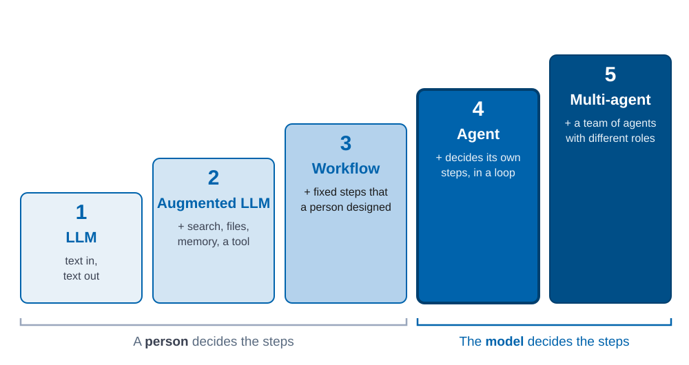
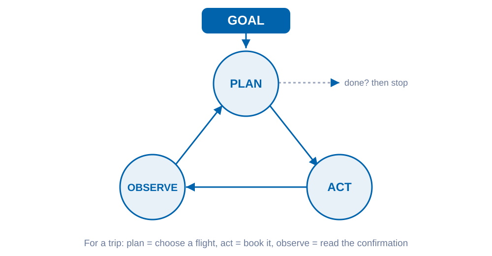
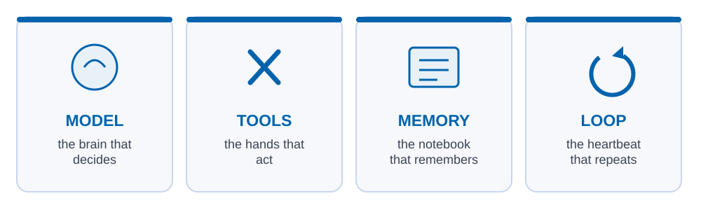
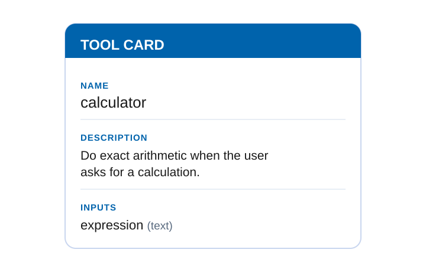
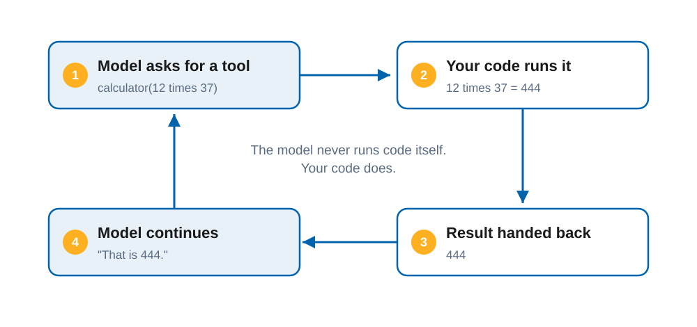
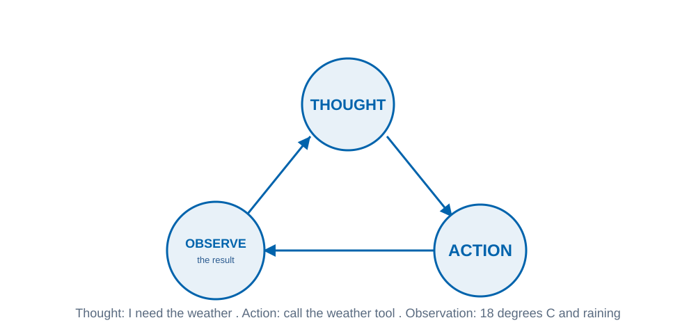
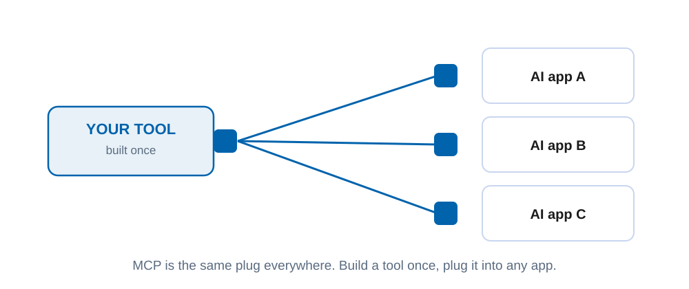

<!-- _class: lead -->

# Tool Use and Agentic Mechanics

Session 1: How AI agents think and act

**UNDP Istanbul International Center for Private Sector in Development**

Prepared by Alan Al-Jammoor

<!-- Welcome everyone. No coding today and nothing to install. Ask: "Who has used ChatGPT, Claude or a similar assistant?" Most hands go up. "Today we look at what happens when that kind of AI stops just answering and starts doing." -->

---

<!-- _class: center -->

## An AI agent made this

<video src="assets/cafe_promo.mp4" controls></video>

<!-- HOOK, 3 minutes. Play the 30 second video. Then say: "An AI agent made this, starting from a messy spreadsheet of café sales. Nobody edited it. Today you learn how that works. Next session, you watch it happen." If the video does not play inside the slides, open assets/cafe_promo.mp4 directly. -->

---

## Today, in plain words

- **Five ways to set up AI**, and why an agent is different
- **Inside an agent**: the loop that powers it
- **Tools**: how an AI reaches out and does things
- **Planning**: how it decides what to do next

No coding. Lots of questions. One volunteer role-play.

<!-- Keep this quick, under a minute. Promise: by the end, everyone can explain how an AI agent works to a friend. -->

---

<!-- _class: divider -->

# Part 1: Five ways to set up AI

Not all AI is the same. Here is the map.

---

## A ladder of five levels

<!-- Walk up the ladder one step at a time, about a minute each. Each level adds one thing to the one before. 1: just the model, text in and text out. 2: the same model with extras, like search or your files. 3: several AI steps in a fixed order that a PERSON designed. 4: the model decides its own steps, in a loop. 5: a team of agents. Point to the bracket at the bottom: that is the line that matters. -->

---

## One everyday example per level

| Level | Example |
|-------|---------|
| **1. LLM** (large language model) | "Rewrite this email to sound more polite." |
| **2. Augmented LLM** | "What time is the last bus?" It reads the timetable PDF first. |
| **3. Workflow** | Every Monday: summarise new feedback, sort it by topic, draft the report. Same steps every time. |
| **4. Agent** | "Plan an event for 50 people under this budget." It searches, compares, finds a venue is full, and changes plan. |
| **5. Multi-agent** | A researcher agent, a writer agent and a fact checker agent produce one report together. |

<!-- Read two or three rows aloud, not all. Ask: "Which of these have you already used without knowing the name?" Most people have used 1 and 2. Define LLM: a large language model, the AI that reads and writes text. -->

---

<!-- _class: center -->

# Who decides the steps?

In a workflow, a person decides the steps. In an agent, the model decides.

That one difference is what this whole course is about.

<!-- Pause here. This is the most important sentence of Part 1. A workflow is like a recipe you wrote. An agent is like a cook you hired: you give the goal, it decides the steps. -->

---

<!-- _class: activity -->

## Quick quiz: which level would you use?

Hands up or poll

<ol class="quiz">
<li>Translate a paragraph into French.</li>
<li>Answer questions about this year's bus timetable PDF.</li>
<li>Every Friday, turn the sign-up sheet into the same summary email.</li>
<li>Find a venue, caterer and date for 50 people under a budget, adapting when options fall through.</li>
<li>Write a 20-page market study, with research, writing and fact checking done by separate specialists.</li>
</ol>

<!-- 3 minutes. Read each one, count to three, hands up for the level number. Reveal on the next slide. -->

---

## Answers

<h3>1. LLM</h3>Text in, text out.

<h3>2. Augmented LLM</h3>It needs the PDF.

<h3>3. Workflow</h3>Same steps every week.

<h3>4. Agent</h3>The steps change as it goes.

<h3>5. Multi-agent</h3>Different roles. But would one agent do?

Not everything needs an agent. Use the simplest level that does the job.

<!-- The point in passing: higher is not better. Agents cost more, take longer and can surprise you. You do not hire a project manager to make a cup of tea. -->

---

<!-- _class: divider -->

# Part 2: Inside an agent

The loop at the heart of every agent.

---

<!-- _class: center -->

## So, what is an agent?

An agent is an AI that works toward a goal by deciding the next step, acting with a tool, looking at the result, and repeating until the goal is met.

<!-- Read it slowly. Key words: goal, step, tool, result, repeat. The same model sits inside a plain chatbot. What makes it an agent is the loop around it. -->

---

## The loop

The goal goes in once. Then plan, act, observe, again and again, until the job is done.

<!-- Trace the loop with your finger. It takes one step, looks at what happened, and only then decides the next step. That is why it copes with messy, real tasks. -->

---

## Four parts, working together

The model decides, the tools act, memory remembers, and the loop keeps it going.

<!-- Brain, hands, notebook, heartbeat. Ask: "When an agent books a meeting room, which part does the booking, the brain or the hands?" The hands: a tool. That leads into Part 3. -->

---

<!-- _class: divider -->

# Part 3: Tools

How an AI reaches out and does things.

---

<!-- _class: center -->

## What is a tool?

A tool is something the AI can ask your computer to do for it: search, calculate, read a file, send an email. The model asks. The computer does the work.

<!-- Analogy: a very smart colleague who can say "please use the calculator" but cannot press the buttons. -->

---

## On its own, a model has three gaps

<h3>No exact maths</h3>It guesses at arithmetic.

<h3>No fresh information</h3>It cannot see today.

<h3>No actions</h3>It can only produce text.

A calculator, a search and an action tool fix all three.

<!-- These gaps are the whole reason tools exist. Each gap maps to a kind of tool. -->

---

## A tool is just a card the model reads

Name, description, inputs. The model picks a tool by reading its description.

<!-- The model never sees the code behind the tool, only this card. Hold up the printed tool card you will use in the role-play. -->

---

## The tool-use loop: ask, run, return, continue

<!-- Four steps, like passing a baton. The model asks for a tool, the computer runs it, the result goes back, the model continues. Now we act it out. -->

---

<!-- _class: activity -->

## Activity: be the agent

Two volunteers, 6 minutes

- **The Model**: may only write requests on sticky notes, using the tool card. Cannot touch the calculator.
- **The Computer**: holds the calculator. Does exactly what the note says, writes the result, hands it back.
- **The room** gives the goal:

"A school has 4,750 students. 18% take the bus. How many bus seats do we need?"

<!-- Round 1: Model writes "calculator: 4750 x 0.18", Computer returns 855, Model announces the answer. Round 2: secretly ask the Model to write a broken request, like "calculator: eighteen percent of the school". Computer hands back "Error: please write numbers only". Model fixes it. Applause. Then ask the room: "What did the Model never do?" It never pressed a button. That is tool use. -->

---

## When a tool fails, hand the failure back

A good tool returns a clear message, not a crash. The agent reads it and tries again.

weather("Springfield")  returns  "Error: many Springfields, add a country",  so the agent tries  weather("Springfield, USA")

<!-- Exactly what happened in round 2 of the role-play. Errors are messages, not dead ends. -->

---

<!-- _class: optional activity -->

Optional: 60 min version

## The description is the steering wheel

<h3>Weak</h3>"does data stuff"  The model is left guessing.

<h3>Your turn, in pairs</h3>Rewrite it in 60 seconds so a model knows exactly <b>what</b> it does and <b>when</b> to use it.

<!-- 60 minute version only. Example strong answer: "Looks up a number from the sales table, such as total sales for a month. Use it when the question needs a figure from the sales data." Hear two answers. -->

---

<!-- _class: divider -->

# Part 4: Planning

How an agent decides what to do next.

---

<!-- _class: center -->

## Why plan?

Planning means breaking a big task into small steps, the way a person would. AI does better one step at a time.

<!-- Ask: "How would you plan a weekend trip?" Nobody books everything in one breath. You list steps. -->

---

## Four planning patterns

<h3>Chain of Thought</h3>"Think step by step" before answering. Shows its working.

<h3>ReAct</h3>Think, act, observe, repeat. Reasoning and tools together.

<h3>Plan and Execute</h3>Write the whole plan first, then follow it, like a recipe.

<h3>Reflection and replanning</h3>Check its own work. If something fails, make a new plan.

<!-- About 2 minutes. ReAct is the one most agents use, and it is the loop you just acted out. Plan and Execute: find the email, draft the reply, send it. Replanning: the flight tool is down, so it tries the train. -->

---

## ReAct: the pattern you will see next session

<!-- This loop is exactly what you will watch a real agent do in Session 2. Thought, action, observation, again and again. -->

---

## Pick the simplest pattern that fits

<h3>Simple question</h3>Just ask, or "think step by step".

<h3>Needs tools</h3>ReAct.

<h3>Steps known up front</h3>Plan and Execute.

<h3>Quality matters most</h3>Add Reflection.

<!-- The cheat sheet to photograph. Patterns combine: ReAct plus Reflection is common. -->

---

## MCP: one standard plug for tools

MCP (Model Context Protocol) is a shared standard for connecting tools, like a USB-C port.

<!-- One minute. Build a connection to a tool once, and any AI app that speaks MCP can use it. -->

---

<!-- _class: center -->

# You stay in charge

Agents can act, so good agents ask before risky steps: spending money, sending messages, deleting things.  You set the goal. You approve the big moves. You can see every step.

<!-- Next session you will see the agent stop and ask permission. That is not a weakness, it is a safety feature. -->

---

<!-- _class: activity -->

## Quick check

Call out the answer

1. Name the four steps of the agent loop.
2. Who actually runs the tool: the model or the computer?
3. Which pattern mixes thinking and acting, step by step?

<!-- Answers: 1. Goal, plan, act, observe (then repeat). 2. The computer. The model only asks. 3. ReAct. -->

---

<!-- _class: center -->

## Next session: watch an agent at work

A real AI agent will clean messy data, build a presentation, make that video, and build a small app, live.  Your job: spot everything you learned today.

Nothing to install. Just bring your curiosity.

<!-- Build anticipation. Tell them there will be a game: agent bingo. -->

---

<!-- _class: lead -->

# Thank you

You now know how an AI agent thinks and acts.

**UNDP Istanbul International Center for Private Sector in Development**

Prepared by Alan Al-Jammoor
