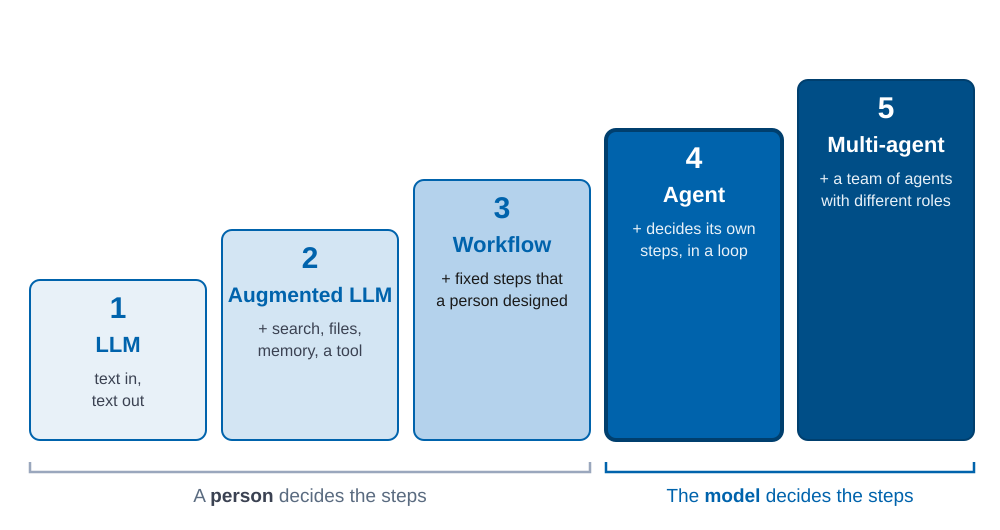
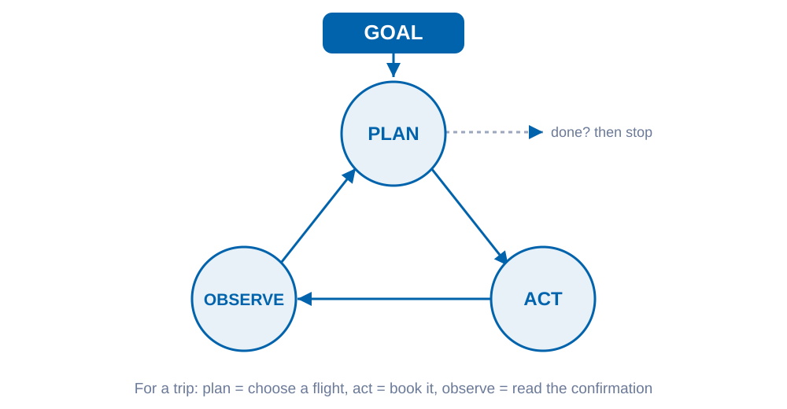

<!-- _class: lead -->

# Tool Use and Agentic Mechanics

Session 2: Watch an AI agent at work

**UNDP Istanbul International Center for Private Sector in Development**

Prepared by Alan Al-Jammoor

<!-- Welcome back. Today nobody needs to install anything. You watch, predict and spot. -->

---

## Last time, in two pictures

An agent decides its own steps, in a loop: plan, act, observe, repeat.

<!-- 2 minutes. Ask: "Who decides the steps in a workflow? And in an agent?" A person, then the model. Ask: "Who actually runs a tool?" The computer. -->

---

<!-- _class: activity -->

## Agent bingo

Shout "bingo!" when you spot one

Made a plan

Used a tool

Hit an error

Tried again

Asked permission

Checked its own work

<!-- Hand out the printed bingo cards (handouts/agent-bingo.html). Each card has the same six squares in a different order. First person to fill a row wins, first to fill the card wins a bigger prize. -->

---

<!-- _class: divider -->

# Part 1: How to talk to an agent

A good prompt is half the result.

---

<!-- _class: center -->

## What is a prompt?

A prompt is a brief to a very capable new colleague on their first day. Smart and fast, but they know <b>nothing</b> about your situation except what you tell them.

<!-- Tie back to Session 1: the model chooses a tool only by reading its card. It does your task only by reading your prompt. If it is not written down, it does not exist. -->

---

## A weak prompt

"Make a presentation about my sales data."

Which file?

For whom?

How long?

Which numbers can it trust?

May it change my file?

What counts as good?

Every question it has to guess is a chance to get it wrong.

<!-- Ask the room for the guesses before revealing them. -->

---

## Five parts of a strong prompt

| Part | It answers | Why it matters for an agent |
|------|------------|-----------------------------|
| GOAL | What do you want, and why? | It loops until the goal is met, so it must know what "met" means. |
| CONTEXT | For whom? What files and facts? | It cannot read your mind or see your situation. |
| RULES | How should it work? What must it never do? | Keeps it safe. "Show me a plan first" adds a human checkpoint. |
| OUTPUT | What exactly should it hand back? | You get something usable, and the next step can pick it up. |
| CHECK | How should it test its own work? | Switches on the <b>observe</b> step: it reviews and fixes its own work. |

<!-- The bigger the task, the more each part earns its place. Every prompt you see today follows these five parts. Watch for them. -->

---

<!-- _class: optional activity -->

Optional: 60 min version

## Your turn: fix this prompt

"Help me plan a birthday party."

In pairs, 2 minutes: rewrite it with GOAL, CONTEXT, RULES, OUTPUT, CHECK.

<!-- 60 minute version only. Take two answers. Point out which part changed the result most: usually CONTEXT (age, budget, number of guests) or OUTPUT (a checklist? a timeline? a shopping list?). -->

---

<!-- _class: divider -->

# Part 2: Watch an agent at work

One café, three jobs, one agent.

---

## Meet the agent: Claude Code

<h3>What it is</h3>An AI agent that works on a computer, in a folder you choose.

<h3>Its tools</h3>Read files, write files, run small programs, search, open a browser.

<h3>Its safety habit</h3>It asks before changing things, and shows its plan first if you ask.

Same loop as Session 1: plan, act, observe, repeat. Now for real.

<!-- Professionals use tools like this every day to analyse data, write documents and build software. Show the terminal window briefly so people see where it runs. -->

---

<!-- _class: demo -->

## Job 1: the café's messy sales records

<pre>
Sep 01 2026,Cappuccino,31,3.50 USD,
01/09/2026,Cheese Pastry,13,"2,80",
2026-09-13,Chicken Sandwich,-1,"6,50",refund
TOTAL SEPTEMBER,,,17321.70,month total from till
05/10/2026,Cheese Pastry,,"2,80",qty smudged
12.10.26,latte,19,$3.80,typed from notebook
</pre>

979 rows like this. Three date formats, typos, refunds, totals mixed in, gaps.

<!-- Ask: "How long would this take you to clean by hand?" Hours. Point out each problem: date formats, a refund, a total line in the middle, a missing quantity, a typo. -->

---

<!-- _class: demo -->

## The prompt we gave it (1 of 2: clean)

| Part | What we wrote |
|------|---------------|
| GOAL | Clean three months of café sales so the owner can see what sells and when. |
| CONTEXT | The file, where it came from, the kinds of mess to expect. The owner is not technical. |
| RULES | Show a plan first. Never edit the original. If a row is unclear, set it aside, do not guess. |
| OUTPUT | A clean file with fixed columns, plain-language cleaning notes, a short summary. |
| CHECK | Compare rows in and out. Recalculate the total and confirm it matches. |

<!-- Point at "do not guess": this stops the AI filling gaps with made-up data. Point at CHECK: that is the observe step. Full prompt text is in prompts.md if anyone asks. -->

---

<!-- _class: demo -->

## The prompt we gave it (2 of 2: present)

| Part | What we wrote |
|------|---------------|
| GOAL | A short presentation to decide next month's menu and opening hours. |
| CONTEXT | Use the clean file and summary from step 1. For the owner and a partner. |
| RULES | Every number must come from the clean data. Plain language. Outline first. |
| OUTPUT | 6 slides, named, in order, with at least two charts. |
| CHECK | Look at every slide as an image. Confirm three numbers against the data. |

The output of step 1 is the input of step 2. That is chaining.

<!-- Now open the finished deck (finished-examples/cafe/cafe_review.pptx). Show the result FIRST. Then rewind: open plan_1A.md, cleaning_notes.md and behind_the_scenes_1A.md. Ask: "Which bingo squares did you see?" -->

---

<!-- _class: demo -->

## Rewind: how did it get there?

<h3>The plan</h3>What did it decide to do first?

<h3>The tools</h3>Which ones, and in what order?

<h3>The surprises</h3>What did it set aside, and why?

<h3>The check</h3>How did it prove the numbers were right?

Then compare its own story with the real log. Check the path, not just the answer.

<!-- Show the agent's behind-the-scenes report next to the log. Its own account can be tidier than what really happened. That is why we look at the log. -->

---

<!-- _class: demo -->

## Job 2: a 30-second video for social media

| Part | What we wrote |
|------|---------------|
| GOAL | A 30-second promo video based on what the sales data showed. |
| CONTEXT | Best sellers, busiest day, café name, opening hours. Locals on their phones. |
| RULES | Storyboard first. Only free tools on this computer. No made-up prices or claims. |
| OUTPUT | Vertical video, 30 seconds, about 5 scenes, ending on name and hours. |
| CHECK | Confirm it plays and lasts 30 seconds. Look at one frame per scene. |

It has no "make video" button. It wrote a small program that draws the video, then checked it.

<!-- Play cafe_promo.mp4 (they saw it in Session 1, now they know what made it). Then open storyboard_2.md. Key lesson: the agent combined simple tools to do something none of them does alone. -->

---

<!-- _class: demo -->

## Job 3, live: an everyday web tool

| Part | What we wrote |
|------|---------------|
| GOAL | A weekly meal planner that turns the meals you pick into one shopping list. |
| CONTEXT | A family who cooks at home, not technical, on a laptop or phone. |
| RULES | One single file, works offline. Large text. 8 dishes built in, add your own. |
| OUTPUT | A 7-day grid, an automatic shopping list, a print button. |
| CHECK | Open it, plan three days, confirm the list adds up and updates. Fix what fails. |

<!-- Now switch to the terminal and run it live (prompt 3 in prompts.md). Before each step ask: "What will it do next?" Watch for the moment it opens its own app in a browser to test it. If it stalls, open finished-examples/meal-planner/meal_planner.html. -->

---

<!-- _class: activity -->

## You are the client

Vote for one change

1. Show it in a language this room speaks
2. Add an estimated cost for the week's shopping
3. Mark vegetarian dishes and add a filter
4. Group the shopping list by type: vegetables, dairy, dry goods

Every change gets its own small CHECK.

<!-- Take a quick vote. Type the winning change as a short prompt with a CHECK line (examples in prompts.md). Watch it go round the loop again. -->

---

<!-- _class: divider -->

# Part 3: What did we just see?

---

## Which level was each job?

<h3>Cleaning data</h3>Agent

<h3>Presentation</h3>Agent

<h3>Video</h3>Agent

And the meal planner it built? No AI inside at all. The agent used AI to build an ordinary tool.

Not everything needs AI. Use the simplest thing that does the job.

<!-- Ask the room before revealing: "Was the meal planner an agent?" Many will say yes. The building was done by an agent. The thing it built is a plain web page. -->

---

<!-- _class: activity -->

## Your turn to think

<h3>Hand it over</h3>What task in your life or work would you give to an agent?

<h3>Keep a human in charge</h3>Where would you want it to stop and ask you first?

<h3>Not worth it</h3>What would be faster with a simple prompt, or no AI at all?

<!-- 5 to 8 minutes. Take three or four answers. Celebrate good "keep a human in charge" answers: money, messages to other people, deleting things, anything about personal data. -->

---

## Keep going

- **Reading list:** `take-home/reading-list.html`, start with the "Start here" items
- **Curious about the code?** `take-home/agent-notebook.ipynb` builds the same loop in Python, step by step, in Google Colab
- **Try it yourself:** write one prompt this week using GOAL, CONTEXT, RULES, OUTPUT, CHECK

<!-- Bingo winners. Thank the room. -->

---

<!-- _class: lead -->

# Thank you

You have watched an AI agent plan, act, check and recover.

**UNDP Istanbul International Center for Private Sector in Development**

Prepared by Alan Al-Jammoor
